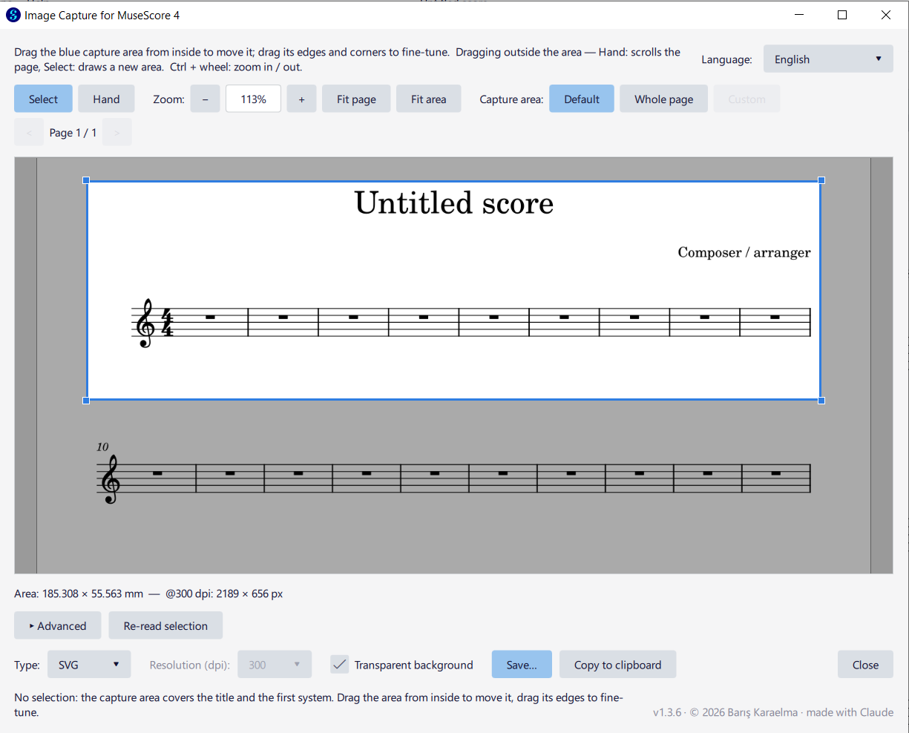

# Image Capture for MuseScore 4

Brings back MuseScore 3's **Image Capture** tool, which was removed in MuseScore 4: save any rectangular region of a score page as **PNG, JPEG, TIFF, SVG or PDF**, or copy it to the clipboard.

[Türkçe açıklama aşağıda ↓](#türkçe)



## Features

- **Opens with the right frame**
  - With a range selection, the frame starts around the selection.
  - Without a range selection, it frames the title and the first system. A single selected element (e.g. a note or a time signature) is ignored.
- **Page viewer**
  - The whole page is shown; use `<` / `>` to switch pages.
  - Zoom with `−` / `+` or Ctrl + mouse wheel. Fit page and Fit frame buttons.
- **Crop frame**
  - Drag the frame from inside to move it. Drag its edges and corners to resize it.
  - Select tool: drag outside the frame to draw a new one. Hand tool: drag to scroll the page.
  - **Whole page** frames the entire page; the same button then becomes **Default frame** to go back.
  - **Advanced:** exact margins around the frame, in spatium.
- **Output**
  - Formats: JPEG, PDF, PNG, SVG, TIFF.
  - Resolution: 72, 150, 300, 600 or 1200 dpi (JPEG, PNG, TIFF).
  - Transparent background (PNG, TIFF, SVG).
  - Copy to clipboard (PNG at the chosen resolution).
- **Languages:** English, Türkçe, Deutsch, Français, Español, Português. The plugin follows MuseScore's interface language; you can also change it in the window.

## Requirements

- MuseScore **4.7** (developed and tested on 4.7.5).
- **Windows:** nothing else needed. **Microsoft Edge** (comes with Windows) or **Google Chrome** is used for PDF export.
- **Linux:** install the helper tools for PDF, TIFF and clipboard:
  ```
  sudo apt install librsvg2-bin imagemagick wl-clipboard xclip
  ```
  (`librsvg2-bin` → PDF, `imagemagick` → TIFF, `wl-clipboard` → clipboard on Wayland, `xclip` → clipboard on X11)
- **macOS:** TIFF and clipboard use built-in tools (`sips`, `osascript`). For PDF install `librsvg` (`brew install librsvg`) or Google Chrome.

## Installation

1. Download this repository (green **Code** button → **Download ZIP**) and extract it.
2. Copy the extracted folder (you can rename it to `ImageCapture`) into your MuseScore plugins folder:
   - Windows: `Documents\MuseScore4\Plugins\`
   - macOS: `~/Documents/MuseScore4/Plugins/`
   - Linux: `~/Documents/MuseScore4/Plugins/`
3. Restart MuseScore.
4. Open **Plugins → Manage plugins…** and enable **Image Capture for MuseScore 4**.

The plugin then appears directly in the **Plugins** menu.

**Tip:** Assign a keyboard shortcut in **Edit → Preferences → Shortcuts**: search for "Image Capture".

## Usage

1. Switch to **Page view** (View → Page view).
2. Optional: select a range of measures.
3. Open **Plugins → Image Capture for MuseScore 4**.
4. Adjust the blue frame.
5. Choose the type and resolution, then click **Save…** or **Copy to clipboard**.

## How it works

The MuseScore 4 plugin API cannot draw the score directly, so the plugin:

1. exports the score pages to temporary SVG files with `writeScore()`;
2. crops the page SVG to the frame by changing its `viewBox` → **SVG**;
3. renders the cropped SVG at the chosen resolution → **PNG / JPEG / clipboard**;
4. converts that PNG with .NET `System.Drawing` (PowerShell) → **TIFF** (Linux / macOS: ImageMagick / `sips`);
5. prints the cropped SVG with headless Microsoft Edge / Google Chrome → **PDF** (Linux / macOS: `rsvg-convert` first, the browser only as a fallback).

### What the plugin runs on your computer

For transparency, the plugin uses these programs in the background:

- **PowerShell** (`-ExecutionPolicy Bypass`, only built-in commands) to:
  - copy finished files to the folder you chose — MuseScore lets plugins write only to its own folder and the temp folder;
  - copy images to the clipboard;
  - convert PNG to TIFF.
- **Microsoft Edge / Google Chrome** in headless mode, with a separate temporary profile, to create PDFs.
- On Linux / macOS instead of PowerShell: `/bin/sh` with `cp`, `rsvg-convert`, ImageMagick (`magick` / `convert`), `wl-copy` / `xclip`, `sips`, `osascript` — only the ones that are installed.

No network access, no data collection. Temporary files are written to your temp folder.

## Limitations

- Works in **Page view** only, not in Continuous view.
- If a selection spans several pages, only the part on the first page is used.
- The clipboard image has no transparency.
- Linux support for PDF, TIFF and clipboard is new in v1.3 and has been confirmed on Ubuntu (clipboard on X11 and Wayland). On macOS the clipboard was reworked in v1.3.4 and still needs confirmation from a Mac user. Ubuntu's Chromium snap cannot be used for PDF (snap confinement), so install `librsvg2-bin`. With the Flatpak version of MuseScore, the helper tools on the host system may not be reachable.
- A cropped SVG still contains the whole page outside the visible area, so its file size is that of the full page.

## About this project

This plugin was developed with **Claude** (Anthropic's AI assistant), using Claude Code. The idea, design decisions and testing were done by **Barış Karaelma**. The code and the research into MuseScore's source code were done by Claude.

Bug reports and pull requests are welcome.

This is an independent project. It is not affiliated with or endorsed by MuseScore, Muse Group or Anthropic.

## License

Copyright (C) 2026 Barış Karaelma

[GNU General Public License v3.0](LICENSE), the same license as MuseScore.

---

## Türkçe

MuseScore 4'te kaldırılan, MuseScore 3'teki **Görüntü Yakalama** aracını geri getirir. Partisyon sayfasındaki herhangi bir dikdörtgen bölge **PNG, JPEG, TIFF, SVG veya PDF** olarak kaydedilebilir ya da panoya kopyalanabilir.

### Özellikler

- **Açılış:** Ölçü seçiliyse çerçeve seçimin çevresinde açılır. Ölçü aralığı seçimi yoksa başlık ve ilk sistem çerçevelenir; tek başına seçili bir öğe (nota, ölçü işareti vb.) dikkate alınmaz.
- **Görüntüleyici:** Tam sayfa görünür. `−` / `+` veya Ctrl + tekerlek ile yakınlaştırılır, `<` / `>` ile sayfa değiştirilir.
- **Çerçeve**
  - İçinden tutup taşınır, kenar ve köşelerinden boyutlandırılır.
  - **Whole page / Tüm sayfa** tüm sayfayı çerçeveler. Aynı buton sonra **Varsayılan çerçeve** olur ve ilk çerçeveye döner.
  - **Gelişmiş:** Çerçeve çevresine spatium cinsinden boşluk.
- **Çıktı:** JPEG, PDF, PNG, SVG, TIFF. 72–1200 dpi çözünürlük, saydam arka plan, panoya kopyala.
- **Diller:** English, Türkçe, Deutsch, Français, Español, Português. MuseScore'un arayüz dilini izler.

### Kurulum

1. Bu depoyu indirin (yeşil **Code** butonu → **Download ZIP**) ve açın.
2. Açılan klasörü (adını `ImageCapture` yapabilirsiniz) `Belgeler\MuseScore4\Plugins\` içine kopyalayın.
3. MuseScore'u yeniden başlatın.
4. **Eklentiler → Eklentileri yönet…** ekranında **Image Capture for MuseScore 4**'ü etkinleştirin.

**İpucu:** **Düzen → Tercihler → Kısayollar** bölümünde "Image Capture" diye aratıp bir klavye kısayolu atayabilirsiniz.

### Kullanım

1. **Sayfa görünümüne** geçin.
2. İsterseniz ölçüleri seçin.
3. **Eklentiler → Image Capture for MuseScore 4**'ü açın.
4. Mavi çerçeveyi ayarlayın.
5. Biçim ve çözünürlüğü seçip **Kaydet…** veya **Panoya kopyala**'ya basın.

### Arka planda çalışan programlar

- **PowerShell:** Dosyaları seçtiğiniz klasöre kopyalamak, panoya kopyalamak ve TIFF'e dönüştürmek için. MuseScore eklentilerin yalnızca kendi klasörüne ve Temp'e yazmasına izin veriyor.
- **Microsoft Edge / Google Chrome:** PDF oluşturmak için, görünmez modda ve ayrı bir geçici profille.

İnternet bağlantısı kullanılmaz, veri toplanmaz.

### Bilinen kısıtlar

- Yalnızca **sayfa görünümünde** çalışır.
- Seçim birden fazla sayfaya yayılırsa yalnızca ilk sayfadaki kısım kullanılır.
- Linux'ta PDF, TIFF ve pano için yardımcı araçlar gerekir: `sudo apt install librsvg2-bin imagemagick wl-clipboard xclip`. macOS'ta PDF için `brew install librsvg` veya Google Chrome gerekir.

### Bu proje hakkında

Bu eklenti, Anthropic'in yapay zekâ asistanı **Claude** ile, Claude Code kullanılarak geliştirildi. Fikir, tasarım kararları ve testler **Barış Karaelma** tarafından; kod ve MuseScore kaynak kodu araştırması Claude tarafından yapıldı. Hata bildirimleri ve katkılar memnuniyetle karşılanır.

Bağımsız bir projedir; MuseScore, Muse Group veya Anthropic ile bağlantılı değildir ve onlar tarafından onaylanmamıştır.

Lisans: [GPL-3.0](LICENSE) · Copyright (C) 2026 Barış Karaelma
