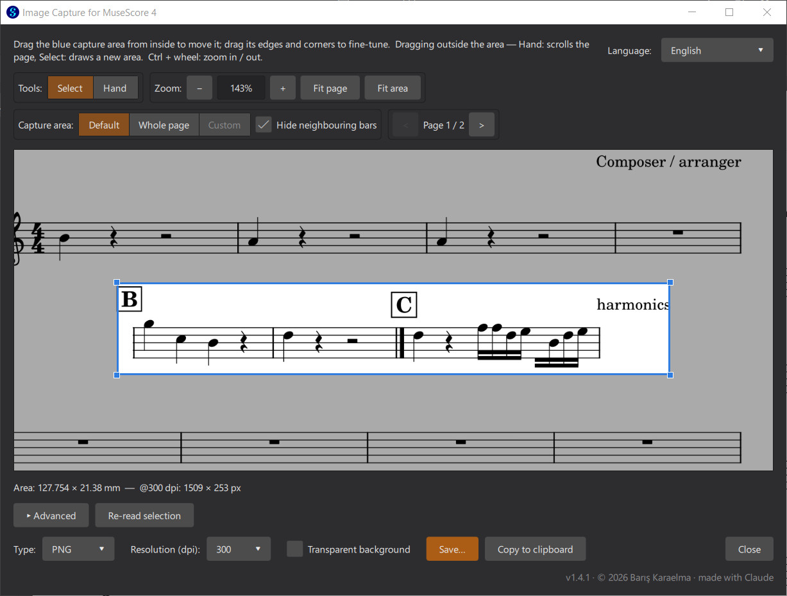

# Image Capture for MuseScore 4

Brings back MuseScore 3's **Image Capture** tool, which was removed in MuseScore 4: save any rectangular region of a score page as **PNG, JPEG, TIFF, SVG or PDF**, or copy it to the clipboard.

Since v1.4 it comes with a second plugin, **Image Capture – Quick Copy**, which copies the selection to the clipboard **without any dialog**, from a keyboard shortcut. It is meant for blind and keyboard-only users, because plugin dialogs cannot be used with the keyboard or a screen reader.

[Türkçe açıklama aşağıda ↓](#türkçe)



## Features

- **Opens with the right capture area**
  - With a range selection, the capture area starts around the selection. Where the selection starts or ends in the middle of a system, the area ends exactly at the barline; marks of the selection that reach across it (e.g. a rehearsal mark centred on the barline) are kept whole.
  - Without a range selection, it covers the title and the first system. A single selected element (e.g. a note or a time signature) is ignored.
- **Page viewer**
  - The whole page is shown; use `<` / `>` to switch pages.
  - Zoom with `−` / `+`, by typing a percentage, or with Ctrl + mouse wheel. **Fit page** and **Fit area** buttons.
- **Capture area** (the blue frame)
  - Drag it from inside to move it. Drag its edges and corners to resize it.
  - Select tool: drag outside the area to draw a new one. Hand tool: drag to scroll the page.
  - **Default** (selection, or title + first system), **Whole page**, or **Custom** (the area you last drew or adjusted).
  - **Hide neighbouring bars** (with a range selection): the bars next to the selection are covered with white, in the preview and in every output, so only the selected bars show. Marks of the neighbouring bars that reach into the selection (e.g. the next bar's rehearsal mark) are hidden too. It cannot be combined with a transparent background: of the two, the one clicked last is used.
  - **Advanced:** exact margins around the area, in spatium.
- **Output**
  - Formats: JPEG, PDF, PNG, SVG, TIFF.
  - Resolution: 72, 150, 300, 600 or 1200 dpi (JPEG, PNG, TIFF).
  - Transparent background (PNG, TIFF, SVG).
  - Copy to clipboard (PNG at the chosen resolution). On macOS: as vectors (PDF + SVG) when the type is SVG or PDF,
    otherwise as PNG, TIFF and SVG.
- **Languages:** English, Türkçe, Deutsch, Français, Español, Português. The plugin follows MuseScore's interface language; you can also change it in the window.

### Quick Copy (no dialog)

Run **Image Capture – Quick Copy** from its keyboard shortcut (or the Plugins menu). A small window says "Copying to the clipboard..." and closes by itself; on an error it stays open with a **Close** button (Esc also closes it).

- **Range selection:** the selected bars, with everything that belongs to them (clefs, lyrics, dynamics, rehearsal marks...). Neighbouring bars are hidden as with **Hide neighbouring bars**.
- **A single element selected** (e.g. a note): the whole page it is on, with the empty margins trimmed.
- **Nothing selected:** the whole first page, margins trimmed.

Resolution, margins and **Hide neighbouring bars** are taken from Image Capture's settings. The clipboard gets a PNG on a white background.

## Requirements

- MuseScore **4.7** (developed and tested on 4.7.5).
- **Windows:** nothing else needed. **Microsoft Edge** (comes with Windows) or **Google Chrome** is used for PDF export.
- **Linux:** install the helper tools for PDF, TIFF and clipboard:
  ```
  sudo apt install librsvg2-bin imagemagick wl-clipboard xclip
  ```
  (`librsvg2-bin` → PDF, `imagemagick` → TIFF, `wl-clipboard` → clipboard on Wayland, `xclip` → clipboard on X11). On ChromeOS (Linux container) only `xclip` is used for the clipboard, because `wl-copy` does not work there: `sudo apt install xclip`.
- **macOS:** TIFF and clipboard use built-in tools (`sips`, `osascript`). For PDF, and for copying to the clipboard as vectors, install `librsvg` (`brew install librsvg`); PDF can also be made with Google Chrome.

## Installation

1. Download this repository (green **Code** button → **Download ZIP**) and extract it.
2. Copy the extracted folder (you can rename it to `ImageCapture`) into your MuseScore plugins folder:
   - Windows: `Documents\MuseScore4\Plugins\`
   - macOS: `~/Documents/MuseScore4/Plugins/`
   - Linux: `~/Documents/MuseScore4/Plugins/`
3. Restart MuseScore.
4. Open **Plugins → Manage plugins…** and enable **Image Capture for MuseScore 4** and, if you want it, **Image Capture – Quick Copy**.

The plugins then appear directly in the **Plugins** menu. The folder must keep `ImageCaptureCore.js` next to the two `.qml` files: both use it.

**Tip:** Assign a keyboard shortcut in **Edit → Preferences → Shortcuts**: search for "Image Capture". For Quick Copy this is what makes it usable without the mouse.

## Usage

1. Switch to **Page view** (View → Page view).
2. Optional: select a range of measures.
3. Open **Plugins → Image Capture for MuseScore 4**.
4. Adjust the blue frame.
5. Choose the type and resolution, then click **Save…** or **Copy to clipboard**.

## How it works

The MuseScore 4 plugin API cannot draw the score directly, so the plugin:

1. exports the score pages to temporary SVG files with `writeScore()`;
2. crops the page SVG to the frame by changing its `viewBox` → **SVG**;
3. renders the cropped SVG at the chosen resolution → **PNG / JPEG / clipboard**;
4. converts that PNG with .NET `System.Drawing` (PowerShell) → **TIFF** (Linux / macOS: ImageMagick / `sips`);
5. prints the cropped SVG with headless Microsoft Edge / Google Chrome → **PDF** (Linux / macOS: `rsvg-convert` first, the browser only as a fallback).

### What the plugin runs on your computer

For transparency, the plugin uses these programs in the background:

- **PowerShell** (`-ExecutionPolicy Bypass`, only built-in commands) to:
  - copy finished files to the folder you chose — MuseScore lets plugins write only to its own folder and the temp folder;
  - copy images to the clipboard;
  - convert PNG to TIFF.
- **Microsoft Edge / Google Chrome** in headless mode, with a separate temporary profile, to create PDFs.
- On Linux / macOS instead of PowerShell: `/bin/sh` with `cp`, `rsvg-convert`, ImageMagick (`magick` / `convert`), `wl-copy` / `xclip`, `sips`, `osascript` — only the ones that are installed.

No network access, no data collection. Temporary files are written to your temp folder.

## Limitations

- Works in **Page view** only, not in Continuous view.
- If a selection spans several pages, only the part on the first page is used.
- The clipboard image has no transparency.
- **Hide neighbouring bars** covers the bars with white rectangles. In an SVG or PDF they are covered, not removed: a vector editor can move the white rectangles away.
- Quick Copy trims the whole page by looking for ink near the music, so a page number or header very close to the first system may be included.
- Linux support for PDF, TIFF and clipboard is new in v1.3 and has been confirmed on Ubuntu (clipboard on X11 and Wayland). On macOS the clipboard was reworked in v1.3.4 and still needs confirmation from a Mac user. Ubuntu's Chromium snap cannot be used for PDF (snap confinement), so install `librsvg2-bin`. With the Flatpak version of MuseScore, the helper tools on the host system may not be reachable.
- A cropped SVG still contains the whole page outside the visible area, so its file size is that of the full page.

## About this project

This plugin was developed with **Claude** (Anthropic's AI assistant), using Claude Code. The idea, design decisions and testing were done by **Barış Karaelma**. The code and the research into MuseScore's source code were done by Claude.

Bug reports and pull requests are welcome.

This is an independent project. It is not affiliated with or endorsed by MuseScore, Muse Group or Anthropic.

## License

Copyright (C) 2026 Barış Karaelma

[GNU General Public License v3.0](LICENSE), the same license as MuseScore.

---

## Türkçe

MuseScore 4'te kaldırılan, MuseScore 3'teki **Görüntü Yakalama** aracını geri getirir. Partisyon sayfasındaki herhangi bir dikdörtgen bölge **PNG, JPEG, TIFF, SVG veya PDF** olarak kaydedilebilir ya da panoya kopyalanabilir.

v1.4'ten itibaren ikinci bir eklenti de var: **Image Capture – Quick Copy**. Seçimi **hiç pencere açmadan**, bir klavye kısayoluyla panoya kopyalar. Görme engelli ve yalnızca klavye kullanan kullanıcılar için düşünüldü; eklenti pencereleri klavyeyle ve ekran okuyucuyla kullanılamıyor.

### Özellikler

- **Açılış:** Ölçü seçiliyse çerçeve seçimin çevresinde açılır; seçim bir satırın ortasında başlıyor ya da bitiyorsa çerçeve tam ölçü çizgisinde biter, seçimin çizgiyi aşan işaretleri (ör. çizginin üstündeki prova işareti) bütün kalır. Ölçü aralığı seçimi yoksa başlık ve ilk sistem çerçevelenir; tek başına seçili bir öğe (nota, ölçü işareti vb.) dikkate alınmaz.
- **Görüntüleyici:** Tam sayfa görünür. `−` / `+`, yüzde yazarak veya Ctrl + tekerlek ile yakınlaştırılır, `<` / `>` ile sayfa değiştirilir.
- **Yakalama alanı** (mavi çerçeve)
  - İçinden tutup taşınır, kenar ve köşelerinden boyutlandırılır.
  - **Varsayılan** (seçim ya da başlık + ilk sistem), **Tüm sayfa** veya **Özel** (en son çizilen / ayarlanan alan).
  - **Komşu ölçüleri gizle** (ölçü seçimiyle): Seçimin yanındaki ölçüler önizlemede ve bütün çıktılarda beyazla örtülür, yalnızca seçili ölçüler görünür. Komşu ölçünün seçime taşan işaretleri (ör. sonraki ölçünün prova işareti) de gizlenir. Saydam arka planla birlikte kullanılamaz; ikisinden en son tıklanan geçerli olur.
  - **Gelişmiş:** Alanın çevresine spatium cinsinden boşluk.
- **Çıktı:** JPEG, PDF, PNG, SVG, TIFF. 72–1200 dpi çözünürlük, saydam arka plan, panoya kopyala.
- **Diller:** English, Türkçe, Deutsch, Français, Español, Português. MuseScore'un arayüz dilini izler.

### Hızlı Kopyala (Quick Copy, pencere açmadan)

**Image Capture – Quick Copy**'yi klavye kısayoluyla (ya da Eklentiler menüsünden) çalıştırın. Küçük bir pencere "Panoya kopyalanıyor..." der ve iş bitince kendiliğinden kapanır; hata olursa **Kapat** düğmesiyle açık kalır (Esc de kapatır).

- **Ölçü seçimi:** Seçili ölçüler, onlara ait her şeyle (anahtar, söz, nüans, prova işareti...). Komşu ölçüler **Komşu ölçüleri gizle**'deki gibi gizlenir.
- **Tek bir öğe seçiliyse** (ör. bir nota): Bulunduğu sayfanın tamamı, boş kenarları kırpılmış olarak.
- **Hiçbir şey seçili değilse:** İlk sayfanın tamamı, kenarları kırpılmış olarak.

Çözünürlük, kenar boşlukları ve **Komşu ölçüleri gizle** Image Capture'ın ayarlarından alınır. Panoya beyaz zeminli PNG kopyalanır.

### Kurulum

1. Bu depoyu indirin (yeşil **Code** butonu → **Download ZIP**) ve açın.
2. Açılan klasörü (adını `ImageCapture` yapabilirsiniz) `Belgeler\MuseScore4\Plugins\` içine kopyalayın.
3. MuseScore'u yeniden başlatın.
4. **Eklentiler → Eklentileri yönet…** ekranında **Image Capture for MuseScore 4**'ü ve isterseniz **Image Capture – Quick Copy**'yi etkinleştirin.

Klasörde iki `.qml` dosyasının yanında `ImageCaptureCore.js` de bulunmalı; ikisi de onu kullanır.

**İpucu:** **Düzen → Tercihler → Kısayollar** bölümünde "Image Capture" diye aratıp bir klavye kısayolu atayabilirsiniz. Quick Copy'yi faresiz kullanmak için bu gerekli.

### Kullanım

1. **Sayfa görünümüne** geçin.
2. İsterseniz ölçüleri seçin.
3. **Eklentiler → Image Capture for MuseScore 4**'ü açın.
4. Mavi çerçeveyi ayarlayın.
5. Biçim ve çözünürlüğü seçip **Kaydet…** veya **Panoya kopyala**'ya basın.

### Arka planda çalışan programlar

- **PowerShell:** Dosyaları seçtiğiniz klasöre kopyalamak, panoya kopyalamak ve TIFF'e dönüştürmek için. MuseScore eklentilerin yalnızca kendi klasörüne ve Temp'e yazmasına izin veriyor.
- **Microsoft Edge / Google Chrome:** PDF oluşturmak için, görünmez modda ve ayrı bir geçici profille.

İnternet bağlantısı kullanılmaz, veri toplanmaz.

### Bilinen kısıtlar

- Yalnızca **sayfa görünümünde** çalışır.
- Seçim birden fazla sayfaya yayılırsa yalnızca ilk sayfadaki kısım kullanılır.
- **Komşu ölçüleri gizle** ölçüleri beyaz dikdörtgenlerle örter. SVG ve PDF'te ölçüler silinmez, örtülür: vektör düzenleyicide beyaz dikdörtgenler kaldırılabilir.
- Quick Copy tam sayfayı notaların çevresindeki mürekkebe bakarak kırpar; ilk sisteme çok yakın bir sayfa numarası ya da üst bilgi görüntüye girebilir.
- Linux'ta PDF, TIFF ve pano için yardımcı araçlar gerekir: `sudo apt install librsvg2-bin imagemagick wl-clipboard xclip`. ChromeOS'ta (Linux kapsayıcısı) pano için yalnızca `xclip` kullanılır, çünkü orada `wl-copy` çalışmıyor: `sudo apt install xclip`. macOS'ta PDF ve panoya vektör olarak kopyalama için `brew install librsvg` gerekir (PDF Google Chrome ile de yapılabilir).

### Bu proje hakkında

Bu eklenti, Anthropic'in yapay zekâ asistanı **Claude** ile, Claude Code kullanılarak geliştirildi. Fikir, tasarım kararları ve testler **Barış Karaelma** tarafından; kod ve MuseScore kaynak kodu araştırması Claude tarafından yapıldı. Hata bildirimleri ve katkılar memnuniyetle karşılanır.

Bağımsız bir projedir; MuseScore, Muse Group veya Anthropic ile bağlantılı değildir ve onlar tarafından onaylanmamıştır.

Lisans: [GPL-3.0](LICENSE) · Copyright (C) 2026 Barış Karaelma
